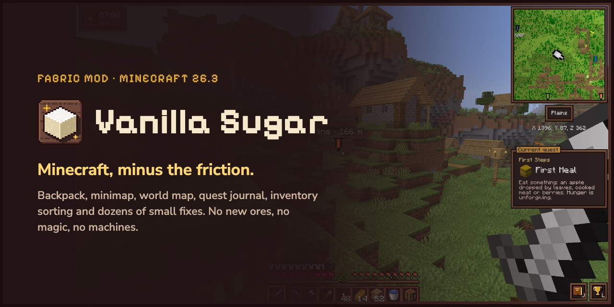

# Cassonade

**Minecraft, minus the friction.** A Fabric mod for Minecraft 26.3 that fixes the hundred small annoyances of survival and leaves everything else alone. No new ores, no magic, no machines: the same game you know, just smoother.

**[Website](https://corentin-gautier.github.io/cassonade/)** · [Modrinth](https://modrinth.com/mod/cassonade) · [CurseForge](https://www.curseforge.com/minecraft/mc-mods/cassonade) · [GitHub releases](https://github.com/corentin-gautier/cassonade/releases)



## The idea

- **Same progression.** No new resources, tiers or dimensions. Every new feature is unlocked by equipping an item you already know (a compass, a clock) or one crafted from vanilla items (a backpack, a world map, a barometer), in its own equipment slot.
- **Every small annoyance, fixed.** Leaves that take minutes to decay, "Too Expensive!", boats stuck on a pixel, the enchanting table's "…?": each fix is small, together they change how the game feels.
- **Feels like it was always there.** The interface keeps Minecraft's pixel style and sounds, features only show up once you equip their item, and every key can be remapped.
- **One style, no settings maze.** A modpack stitched from a dozen mods brings a dozen visual styles and options scattered across as many config screens, until the game is hard to find your way around. Cassonade looks the same everywhere and has nothing to configure on purpose: each feature works one way, as close to vanilla as it gets, and that's it.

What Cassonade will never add: new ores, metals or gear tiers; magic, machines or tech trees; new mobs, biomes or dimensions; anything that makes the game easier to beat rather than nicer to play.

## Features

### Backpack


54 more slots, as much as a large chest. Craft it from 4 leather, 4 string and a bundle:

```
 S L S     L = leather, S = string, B = bundle
 S B S
 L L L
```

- Wear it in its own equipment slot (Shift-click it in the inventory), then open it with `B` or from the tab at the top of the inventory. It opens in a leather panel where the recipe book usually sits; opening one closes the other.
- While it is open, Shift-click sends items straight into it.
- Like a Shulker box, it keeps its contents when placed in a chest or dropped. A backpack or a Shulker box cannot go inside a backpack.
- On death, it drops like the rest of your inventory, unless `keepInventory` is on.

### Compass minimap


Equip a compass in its slot to get a minimap in the top-right corner, drawn with the colors of vanilla maps.

- `+` and `-` zoom from 32 to 256 blocks across. The biome and your coordinates are written underneath.
- The "N" button next to the minimap, or `R`, switches between north-up and a map that turns with you.
- Your markers show in the world, through terrain, as their banner with their name and distance, smaller the farther they are. `N` cycles between icon and text, icon only, or hidden.
- In the Nether, the map shows the floor you stand on, not the bedrock ceiling.

### World map and markers


Craft a world map from an empty map surrounded by eight sticks, and equip it in the map slot:

```
 S S S     E = empty map, S = stick
 S E S
 S S S
```

- `M` (or the tab at the top of the inventory) opens a full-screen map of every chunk you have explored in this dimension, under a fog of war.
- Drag to move, `+` / `-` or the mouse wheel to zoom, `Space` to recenter on yourself.
- Right-click to place a marker, with an optional name and one of the 16 dye colors; right-click a marker to remove it. Markers show as banners of their color on the world map, on the minimap and in the world. You can have up to 64, and they are kept on death.
- Where you last died shows as a red X, on the maps and in the world. It goes away once you get back there, or with a right-click on the world map.
- The world's spawn chunk, where you come back without a bed, is outlined on the world map.
- The lodestone each of your lodestone compasses points to shows as a white X on the minimap and the world map, named after the compass if you renamed it.
- **Ping**: `Shift` + middle click on a spot or a mob, up to 128 blocks away, and every player in the dimension sees it marked by a red point with your name for a few seconds, following the mob. No map needed. Middle click alone still picks the block.
- Coordinates written in the chat (`120 64 -300`, `x: 120, y: 64, z: -300`) become links: a click opens the world map there, ready to name a marker.
- Exploration is recorded from the first minute, even before you craft the map.

### Clock


Equip a clock to see, in the top-left corner:

- the time and the current weather;
- the day count and the moon's phase;
- when you can sleep, a soft chime, and the moon blinks with a small bed for a few seconds.

Combine the clock with a lightning rod to make a **barometer**, and wear it in the clock's slot instead: the panel also shows **the next weather change**, read from the server's own weather timers.

In the Nether, the clock spins, just like in vanilla.

### An inventory that keeps up


- **Sort** a chest, barrel, ender chest, Shulker box, your backpack or your inventory with the small buttons next to the titles, or middle-click a slot.
- **Stash**: one click puts into the open chest the items it already holds.
- **Search** a chest, Shulker box or backpack: press `Ctrl+F` (`Cmd+F` on Mac) or click the `F` button. Names, item IDs, enchantments and items inside bundles or Shulker boxes are matched; other stacks dim.
- **Shift-drag** across a row to move every stack you pass over.
- **Scroll wheel**: scroll down over a stack to move its items one at a time, where a Shift-click would send the stack.
- **Locked slots**: `Alt`-click a slot of your inventory or hotbar to lock it, marked with a padlock. Sorting, stashing, Shift-click and Shift-drag leave it alone, and the drop key (`Q`) won't throw it away, so a building block stays where your hand expects it, and still gets refilled when its stack runs out. `Alt`-click again to unlock it.
- **Bundles**: drag a bundle over items to fill it, or right-drag over empty slots to empty it.
- **Previews**: see inside bundles, Shulker boxes, backpacks and filled maps on hover. Food shows the hunger it restores and its saturation, how long it keeps you full, as drumsticks.
- **Food in hand**: the drumsticks it would restore blink on the hunger bar.
- **Enchantment descriptions**: what each enchantment does, under its name: always on enchanted books, on enchanted gear while `Shift` is held.
- **Anvil penalty**: an item already worked at the anvil shows, at the bottom of its tooltip, the levels the anvil adds to every new use on it.
- **Fuel**: in a furnace, blast furnace or smoker, a fuel's tooltip says how many items it smelts (coal 8, a plank 1.5).
- **Brewing**: a brewing stand shows how long its current batch has left and how many fuelled batches remain.
- **Picked up**: what you pick up is listed discreetly on the right of the screen for a few seconds, the same item's pickups added up.
- **New items**: what you just picked up carries a small golden dot in your inventory, until your cursor passes over it.
- **Hotbar rows**: `G` rotates your inventory rows into the hotbar: the row just above comes down into it, and the hotbar goes up to the top row. Four presses bring everything back, so each row can hold a set (tools, building blocks, food and torches). A column with a locked slot stays put.
- **Hand refill**: when the stack in your hand runs out (last block placed, last food eaten, tool broken), a matching stack from your inventory takes its place.
- **Durability warning**: when an enchanted tool, weapon or armor piece wears down to its last 5 % (or 10 uses), then right before it breaks, a soft crack, a message above the hotbar and the item blinking red.
- **Bulk crafting**: `Ctrl`-click (`Cmd` on Mac) a recipe in the recipe book to craft as many as your inventory allows.
- Soft sounds on inventory clicks, where vanilla stays silent.

### Right-click harvest


Right-click a ripe crop to harvest and replant it: wheat, carrots, potatoes, beetroots, nether wart and cocoa. You get the same drops as breaking it, Fortune included, minus the seed that goes back in the ground. Sneak to use the vanilla right-click.

### Elytra slot


Elytra get their own slot, next to the offhand: fly without taking your chestplate off. Right-click them or Shift-click them in the inventory to equip them. They fly, wear out and take Mending exactly as in vanilla, and other players see your wings over your armor.

### Filtered hopper


Every hopper gets a filter slot: put one item in, and the hopper only accepts that item. A row of hoppers with filtered hoppers underneath makes a full item sorter, no redstone needed.

- A bundle or a shulker box in the filter slot lets through every item it holds. An empty one filters bundles or shulker boxes, like any other item.
- The filter compares the item, not its enchantments or name.
- Speed, redstone locking and comparators stay vanilla.
- Filtered hoppers are recognizable by the iron grate inside.

### Quest journal and advancements


- **Quest journal** (`J`): twelve chapters that walk you from your first night to the toughest challenges, following Minecraft's own advancements. It is offered when you start a world, and you can turn it on or off at any time.
- **Current quest**: shown under the minimap with its progress. Click it to open the journal; `K`, shown in its corner, shrinks it, hides it or shows it again.
- **Advancements screen** (`L`): every advancement in one book, with what is left for each (biomes to visit, mobs to kill…) and a filter for what is done or still to do.
- **Celebrations**: earned advancements are announced in the middle of the screen, bigger for goals and challenges.


### Combat awareness


Combine a compass with a sculk sensor (found in the deep dark, it only drops with Silk Touch) to make a **sculk compass**, and wear it in the compass's slot instead: it shows the minimap as well, and senses the mobs around you.

- A health bar over mobs in a fight, which shows the damage you just dealt.
- A golden "!" when a mob starts chasing you.
- An eye in the corner of the screen while anything is hunting you, even out of sight, with the number of pursuers.
- A red dot on the minimap for each mob hunting you, on its edge when the mob is farther, so you know where it comes from.
- The other players around you on the minimap, as blue markers with their name, on its edge when they are farther.

### Spyglasses


Looking through a spyglass, you see through a round lens at the end of a dark tube instead of vanilla's square window, and the scroll wheel zooms one step further in or out than vanilla, the spyglass staying in hand.

Combine a spyglass with a book and a sculk sensor (found in the deep dark, it only drops with Silk Touch) to make a **naturalist's spyglass**. It zooms like a spyglass, and while you look through it, a small panel under the crosshair reads what you see, up to 128 blocks away, through grass and flowers:

- **Horses, donkeys, mules and llamas**: their speed, jump height and health, and a llama's strength, each as a bar from the worst a horse can be born with to the best, red to green.
- **Animals**: whether they are ready to breed, or how long until they are, and when a baby grows up.
- **Villagers**: their level, and how many of their trades are sold out.
- **Crops**: how far they have grown, or that they are ripe. **Beehives**: their honey.

### Sculk torch

Combine a torch with a sculk sensor (found in the deep dark, it only drops with Silk Touch) to make a **sculk torch**. Held in either hand, it lights around you like a torch, and lays a faint creeper's face on every block around where monsters can spawn: dark where they can at any time, light where only the night lets them. Light those spots up and the faces go away.

### Small tweaks

| | Vanilla | With Cassonade |
|---|---|---|
| Cutting down a tree | Leaves decay one by one for minutes | Leaves fall right away, drops included |
| Walking under trees | Leaves at head height | Taller trunks, two blocks of air under the canopy |
| Repairing at the anvil | "Too Expensive!" | Any repair you can pay for |
| Enchanting table | One enchantment, then "…?" | Every enchantment the option will give |
| Mending and Infinity | Incompatible on a bow | Work together |
| Boats on land | Stuck on a 1-pixel step | Glide over paths, farmland, carpets, snow |
| Double doors | Open each door separately | Both open together |
| A sign on a chest | Clicking it edits the sign | Clicking it opens the chest or barrel (sneak to edit the sign) |
| An item frame on a chest | Clicking it turns the item | Clicking it opens the chest or barrel (sneak to turn the item) |
| Named chests | The name only shows once opened | Look at a chest or barrel renamed at the anvil: its name shows |
| Composter | 1 bone meal, after a delay | 8 bone meal, right away |
| Bone meal | Does nothing on sugar cane and cactus | Grows them by one block |
| Daytime | 10 minutes, then night falls | 20 minutes, the night is unchanged |
| Going to bed | 5 seconds to skip the night | 2.5 seconds |
| Death screen | Buttons locked for a second | Respawn immediately |
| Nether portal | 4 seconds of warping and noise | Step in, you're through |
| Moving villagers | Boats, rails, trapping | Put them on a lead |
| Getting hit | The screen flashes red | A red arc around the crosshair points where the hit came from |
| A mob in tall grass | The hit cuts the grass | The hit goes through grass, flowers and crops to the mob |
| Torch in hand | Lights nothing until placed | Lights up around you, as do torches dropped, held by others or burning mobs |
| Item frames | Always show their frame | Shears hide the frame, leaving the item on the wall |
| Ladders | Placed one by one, from the bottom | Right-click a ladder with one: it extends upward, or downward when looking down |
| Farmland | Turns back to dirt when you jump on it | Only mobs trample it, never players, on foot or riding |
| Furnaces | Watch the arrow fill | How long until everything is cooked, and how many more items the fuel will cook |
| Grindstone | The experience it gives back is a surprise | Shown before you take the item, as a range (it is random) |
| Note blocks | Count the clicks to know the note | Look at one: its note (F♯3 to F♯5) and how many clicks it is tuned up |
| Sweeping a sword | Also hits your own wolf or horse | Spares the animals you tamed |
| Your name in the chat | Easy to miss | A soft bell, and your name in gold |
| Armor stands | Take each piece off, one click at a time | Sneak and right-click with an empty hand: your whole armor swaps with the stand's |
| Armor stand arms | Only with commands | Placed with arms, as in Bedrock Edition; shears take them off |

### Fair recipes

Some vanilla recipes eat a whole block for a single button. Cassonade only changes how many items a recipe gives, never its shape or when you unlock it.

| Item | Vanilla | Cassonade |
|---|---|---|
| Buttons | 1 block → 1 | 1 block → 16 |
| Pressure plates (except weighted) | 2 blocks → 1 | 2 blocks → 16 |
| Wooden trapdoors | 6 planks → 2 | 6 planks → 24 |
| Sticks | 2 planks → 4 | 2 planks → 32 |
| Ladders | 7 sticks → 3 | 7 sticks → 8 |
| Stairs | 6 blocks → 4 | 6 blocks → 8 |
| Wood (bark) | 4 logs → 3 | 4 logs → 4 |
| Signs | 6 planks + 1 stick → 3 | 6 planks + 1 stick → 12 |
| Wooden doors | 6 planks → 3 | 6 planks → 12 |
| Bowls | 3 planks → 4 | 3 planks → 12 |
| Paper | 3 sugar cane → 3 | 3 sugar cane → 6 |
| Chests | 8 planks → 1 | 8 planks → 8 |
| Barrels | 6 planks + 2 slabs → 1 | 6 planks + 2 slabs → 8 |

Stairs and slabs can also be crafted back into full blocks, without loss: 4 stairs give 3 blocks, 2 slabs side by side give 1. A block of wool of any color gives back its 4 string.

### A refined interface


A cleaner, warmer look for every screen, still in Minecraft's style: sepia wood panels, dark slots and cream text across the HUD, the chat, inventories, buttons and tooltips; the world softly blurred behind open windows; status effects framed in the top-right corner, with their time left in a corner of the icon; a recipe book that looks like a book, and an animated book on the enchanting table.

## Controls

Every key can be changed in Options → Controls → Key Binds → Cassonade. Letter keys, `+` and `-` follow the character printed on your keyboard, so they work on AZERTY and other layouts too.

| Key | Action | Needs |
|---|---|---|
| `B` | Open / close the backpack | Backpack |
| `M` | Open the world map | World map |
| `Space` | Recenter the world map on yourself | World map |
| `+` / `-` | Zoom the minimap | Compass |
| `R` | Switch the minimap between north-up and turning with you | Compass |
| `N` | Show / hide markers in the world | Compass |
| `J` | Open the quest journal | |
| `L` | Open the advancements screen | |
| `K` | Shrink / hide the current quest | |
| Middle click | Sort the part of the window under the cursor (Survival) | |
| `Alt` + click | Lock / unlock an inventory slot | |
| `G` | Rotate the inventory rows into the hotbar | |
| `Shift` + middle click | Point out a spot or a mob to the other players | |
| `Ctrl` / `Cmd` + click | Craft a recipe as many times as possible | |

Display choices (minimap zoom, map rotation, marker display, quest tracker) are remembered between sessions.

## Install

Requires **Minecraft 26.3**, **[Fabric Loader](https://fabricmc.net/use/) 0.20.1** or later, **[Fabric API](https://modrinth.com/mod/fabric-api)** and **Java 25**.

1. Install the Fabric Loader for Minecraft 26.3.
2. Download Fabric API and Cassonade from [Modrinth](https://modrinth.com/mod/cassonade), [CurseForge](https://www.curseforge.com/minecraft/mc-mods/cassonade) or the [GitHub releases](https://github.com/corentin-gautier/cassonade/releases).
3. Put both `.jar` files in the `mods` folder of your Minecraft directory.
4. Launch the game with the Fabric profile.

**Multiplayer:** install the mod on the server and on every player's game. In singleplayer, there is nothing else to do. If you join a server without the mod, the game stays playable and falls back to vanilla where the server is needed: no extra slots, backpack or sort buttons, no weather forecast or chest names, no "!" or eye in combat, and the vanilla enchanting and advancement information.

## Questions and support

- **Found a bug or have an idea?** [Open an issue](https://github.com/corentin-gautier/cassonade/issues).
- **Can I use it in my modpack?** Yes, see the license below.
- **Enjoying the mod?** You can support its development with a coffee on [Ko-fi](https://ko-fi.com/corentingautier).

Want to build the mod, fix something or translate it? See [CONTRIBUTING.md](CONTRIBUTING.md).

## License

Cassonade is released under the [GPL-3.0](LICENSE): you can include it in a modpack, change it or reuse its code, as long as the resulting version stays under the GPL-3.0, credits its author and publishes its source. Version 0.1.0-alpha.1, released under CC0, remains so.

Not an official Minecraft product. Not approved by or associated with Mojang or Microsoft.
